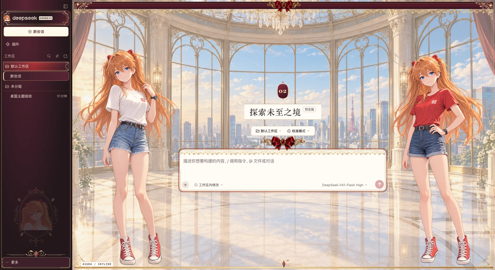
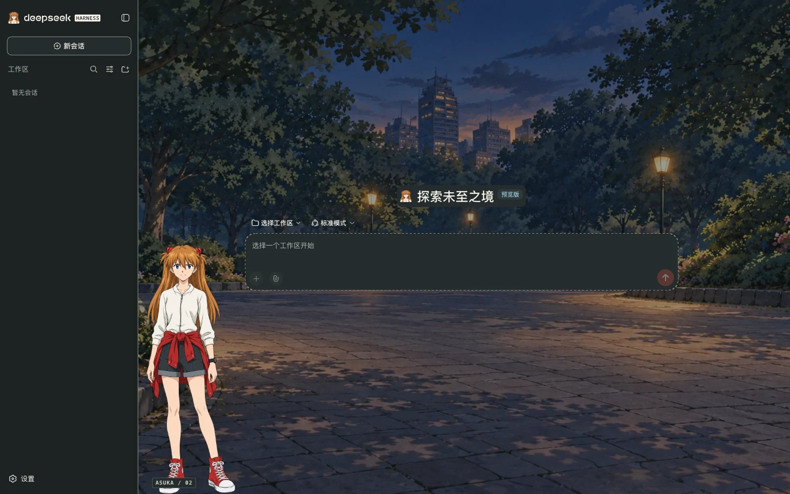
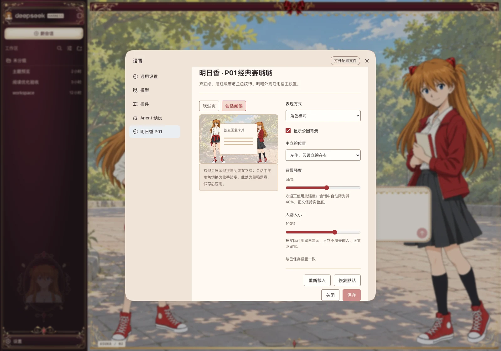

# 明日香 · 绯色天际

`dsh-skin-asuka-p01` 为 DeepSeek Harness 提供精绘双人物、城市穹顶日夜场景、酒红金饰框架和清晰的阅读卡片。

当前版本 **0.6.1**，声明兼容 **DeepSeek Harness 0.1.7-rc.2 ～ 0.2.x**（桌面端当前运行时为 **0.2.1-rc.2**）。0.1.5-rc.2 请继续使用旧的 0.4.1 构建产物。

## 0.6.1 设置可保存与源码重构

**修复设置无法保存**：桌面端 0.2.1-rc.2 的配置表单快照去掉了 `mode` 字段，0.6.0 据此把主题设置页判为只读（提示“当前连接不支持持久化写入”），保存也会失败。现在只在旧版宿主明确报告 memory 模式时才禁用写入。开发依赖对齐 `0.2.1-rc.2`（`@deepseek-ai/schemastery` 同步到 3.18.5），类型检查直接对着桌面端当前运行时进行。

**源码重构**：外观与行为不变，只调整源码组织，方便后续维护：

- **配色单一来源**：浅色、深色与强制色配色集中在 `src/client/palette.ts`，样式变量和宿主令牌层都由它生成，不再在运行时用正则解析 CSS。
- **样式按区域拆分**：原 `theme.css`／`chrome.css` 拆为 `src/client/styles/` 下的八个文件，删除被后续规则完全覆盖的旧声明和未使用的变量。
- **人物布局独立**：避让与尺寸计算抽成纯函数 `scene/layout.ts`，DOM 挂载、观察者与清理留在 `scene/index.ts`。
- **设置页拆分**：草稿、保存与冲突处理集中到 `settings/draft.ts`，预览和表单分开。
- **偏好范围共用**：Host Schema、解码器与设置滑块共用同一组取值范围。

重构前后在同版宿主中逐节点比对了欢迎页、会话页、账号菜单和主题设置页（浅深色、1024～1440px）的计算样式与布局，结果一致。

## 0.6.0 兼容声明对齐桌面端

此前 `peerDependencies` 把 `@deepseek-ai/dsh` 钉死在 `0.1.7-rc.2`。DSH 在加载插件前，会把每个 DSH peer 声明与运行时版本逐一比对（`satisfies(runtimeVersion, range, { includePrerelease: true })`），不匹配就拒绝加载，必须由用户在插件页逐版本确认豁免；而**豁免不随插件升级继承**，于是每次发版都要重新确认一次。

本次把声明改为范围 `>=0.1.7-rc.2 <0.3.0`，同时覆盖开发基线 `0.1.7-rc.2` 与桌面端当前运行时 `0.2.0-rc.2`，安装后无需再逐版本确认。开发依赖（`@deepseek-ai/dsh-settings`、`@deepseek-ai/dsh-client-ui-*`）一并升到 `0.2.0-rc.2`，类型检查与构建直接对着桌面端运行时进行 —— 本次 `tsc --noEmit` 无报错，插件代码无需改动。

## 0.5.1 间距修复

消息尾部的元信息／操作底板此前只有背景和圆角、没有内边距，里面的图标与时间戳会直接顶到板的边缘（时间戳贴右边缘最明显）。本次给这类底板补上统一的四边内边距：上下 6px、左右 12px，与"过程活动"按钮的内边距一致，并把该刻度收敛为 `--asuka-plate-block` / `--asuka-plate-inline` 两个令牌，后续新增底板直接复用。

## 0.5.0 新版桌面适配

0.4.1 依赖的 `settingsScope` 和 `settings.register` 已从新宿主移除。隔离环境中已复现旧包在 0.1.7-rc.2 启动时出现 `pending (waiting for service: settingsScope)`；本次改为新版 `Config`、可实时修改的配置字段及 `configForms`。

- **设置可用**：五项主题偏好继续提供草稿、保存、恢复默认和跨窗口冲突提示；明确处理宿主拒绝写入的结果。
- **窗口顶部**：复用 macOS 原生顶栏预留空间，避免与皮肤额外留白叠加；常驻会话标题栏恢复清晰的酒红底与浅色文字。
- **账号菜单**：适配新版账号／“更多”入口，保留头像、设置、反馈等原生菜单行为。
- **工作过程分组**：为新分组摘要提供实色背景；折叠内容不再被外层阅读留白撑开，组内工具记录保持紧凑。
- **代码操作**：保留新版代码块的原生换行开关，不再用皮肤样式强制关闭换行。
- **内容宽度**：适配宽度变量的新位置，阅读列默认最大920px，欢迎页输入框最大800px，会话输入框与阅读列对齐；宿主拖动调宽继续有效。
- **字号一致**：正文和输入框与“通用设置”的字号一致，不再额外增加2px。舒适阅读可在通用设置选择16px。过程文字及代码继续按宿主字号缩放。
- **设置布局**：保存、关闭等操作移到整行操作区，并在设置内容滚动时保持可见。

人物、背景、暖白阅读面、差异代码的深绿／暗红配色及深色对应配色继续沿用。装饰不接管会话、模型、工具或权限行为。

## 安装到桌面端

1. 确认 DeepSeek Harness 版本落在声明范围内（**0.1.7-rc.2 ～ 0.2.x**，桌面端当前为 0.2.1-rc.2）。
2. 打开侧栏 **插件 → 添加插件**。
3. 填入本机安装包的绝对路径，例如 `/绝对路径/dsh-skin-asuka-p01-0.6.1.tgz`。
4. 完成安装，按界面提示选择 **立即启用**，随后重启应用以完整重新加载插件组合。
5. 从左下角账号／**更多 → 设置 → 明日香 P01** 打开主题设置。

本项目生成的安装包位于：

```text
dist/dsh-skin-asuka-p01-0.6.1.tgz
```

桌面端通过应用内插件页管理自身配置。安装包已经包含运行代码与图片，无需在插件目录中重新构建。

如果仍然显示默认配色、没有人物，也没有“明日香 P01”设置项，先在插件页确认本包已安装并启用。只有专注模式关闭人物时，酒红配色和主题设置入口仍然存在。

## 配置与升级

新版设置入口为 **账号／更多 → 设置 → 明日香 P01**；独立 Web 环境也可能直接显示“设置”按钮。

| 设置 | 默认值 | 行为 |
| --- | --- | --- |
| 表现方式 | 角色模式 | 专注模式隐藏人物和穹顶场景，保留主题配色 |
| 显示穹顶背景 | 开 | 可独立关闭场景图片 |
| 主立绘位置 | 白衣在左 | 可交换两套不同姿态的位置 |
| 背景强度 | 55% | 欢迎页使用此值；会话两侧采用其40%，中间进一步淡化 |
| 人物大小 | 100% | 可选60–120%；仍受实际留白与输入区位置约束 |

宽屏会话人物默认最高420px；空间不足时缩小、仅显示一侧或隐藏。人物不覆盖正文、输入、审批和弹层。窄桌面窗口优先保留阅读与操作空间。

修改设置时只预览当前草稿，点击“保存”后才应用；关闭设置不会自动保存草稿。其他窗口已修改同一配置时，保留当前草稿并提示重新载入，避免覆盖别人的修改。恢复默认同样需要保存，不会重置通用设置的字号和明暗偏好。

0.5.0 的设置按宿主插件条目 `ui-skin-asuka-p01` 保存到当前 profile，使用官方实时配置通道。**不自动搬迁0.4.x的旧 `asuka-p01` 设置文档**；从旧宿主升级后，请在主题页重新核对并保存五项选项。此插件不删除旧设置文档，也不更改其他插件配置。

## 预览

| 浅色欢迎页 | 深色欢迎页 |
| --- | --- |
|  |  |

[浅色会话](preview/active-light.webp) · [深色会话](preview/active-dark.webp) · [浅色代码差异](preview/diff-light.webp) · [深色代码差异](preview/diff-dark.webp)

[账号／更多菜单](preview/account-menu.webp) · [通用设置](preview/general-settings.webp)



预览使用本地离线内容和通用字号16px，没有执行模型或工具调用。桌面布局在隔离浏览器中启用 macOS 布局标记及最小桌面桥接替身，运行的是桌面应用随附的同版官方渲染模块；这些图片不是现用账号或真实 Electron 原生窗口的截屏。

## 验证范围

0.6.1 使用安装在本机的 DeepSeek Harness 随附运行模块（**0.2.1-rc.2**）、独立的 `DSH_HOME` 测试配置和本地回环地址验证；会话内容由本机模拟的模型接口生成，没有调用真实模型。

- 0.6.0 在 0.2.1-rc.2 上设置页只读的复现，以及 0.6.1 安装包的安装与启用。
- 重构前后逐节点比对欢迎页、会话页（含工作过程分组、代码差异、终端输出与宽表格）、账号菜单和主题设置页，覆盖浅深色及1024、1280、1440px窗口。
- 五项主题设置的保存、写入profile、刷新保留、恢复默认、跨窗口冲突提示与重新载入，以及人物换边与缩放。

0.6.0 及更早版本另在 0.2.0-rc.2 上验证过 macOS 顶栏布局、设置操作区、插件面板导航和1600、1920px窗口。

没有修改用户现用的 `desktop` 配置，没有使用真实登录账号。Electron 原生窗口拖动、原生菜单和真实账号登录／退出未纳入验证；0.1.7-rc.2～0.2.0 宿主本轮未复测，Windows／Linux原生桌面窗口以及其他宿主版本仍需单独验证。

## 从源码构建

```sh
npm ci
mkdir -p dist
npm pack --pack-destination dist
```

`prepack` 会执行 TypeScript 检查与构建。也可单独运行：

```sh
npm run typecheck
npm run build
```

安装包只包含清单内的运行文件、说明与预览图，不包含源码原图、开发依赖或临时验收脚本。图片由构建流程编码并内嵌到客户端，不依赖运行时图床；React与Cordis复用宿主运行时。

贡献者可使用同版独立 Web profile 验证：

```sh
dsh --profile asuka-test --from-default-profile web --dump-config
dsh plugin --profile asuka-test add "/绝对路径/dsh-skin-asuka-p01-0.6.1.tgz"
dsh --profile asuka-test --host 127.0.0.1 --no-open
```

该示例用于独立 Web 开发配置。桌面安装使用前面的应用内插件页。

| 文件 | 职责 |
| --- | --- |
| `src/index.ts` | Host Config schema与自定义设置页策略 |
| `src/preferences.ts` | 配置条目id、五项偏好、默认值、取值范围与校验 |
| `src/client/index.tsx` | 客户端入口：注入样式与令牌层、挂载场景、注册插槽 |
| `src/client/palette.ts` | 浅深色与强制色配色，生成样式变量与宿主令牌层 |
| `src/client/stylesheet.ts` | 按层叠顺序拼接样式文件与美术变量 |
| `src/client/styles/` | 令牌、人物舞台、会话阅读、输入框、欢迎页、品牌标记、设置页、侧栏与标题栏样式 |
| `src/client/scene/` | 场景挂载与清理（`index.ts`）、人物避让计算（`layout.ts`） |
| `src/client/settings/` | 草稿与保存（`draft.ts`）、预览（`preview.tsx`）、设置页（`index.tsx`） |
| `src/client/brand.tsx` | 侧栏头像与欢迎页徽章 |
| `src/client/ornaments.ts` | 金属角花、边饰与铭牌 |
| `scripts/build.mjs` | 编码图片并构建Host／Client产物 |

部分装饰与阅读面依赖官方渲染器的DOM标记。宿主升级后应重新验证这些结构，而不是通过跳过版本检查来假定兼容。

## 停用与许可

仅需减少人物装饰，可以在主题设置中选择“专注模式”并保存。完整停用或移除请使用桌面插件页，并按页面提示重新加载应用。

代码与素材的授权边界见 [LICENSE](LICENSE) 和 [NOTICE](NOTICE)。明日香相关角色权利属于原权利人，本项目不是官方授权作品；素材不随代码许可自动取得再分发授权。
